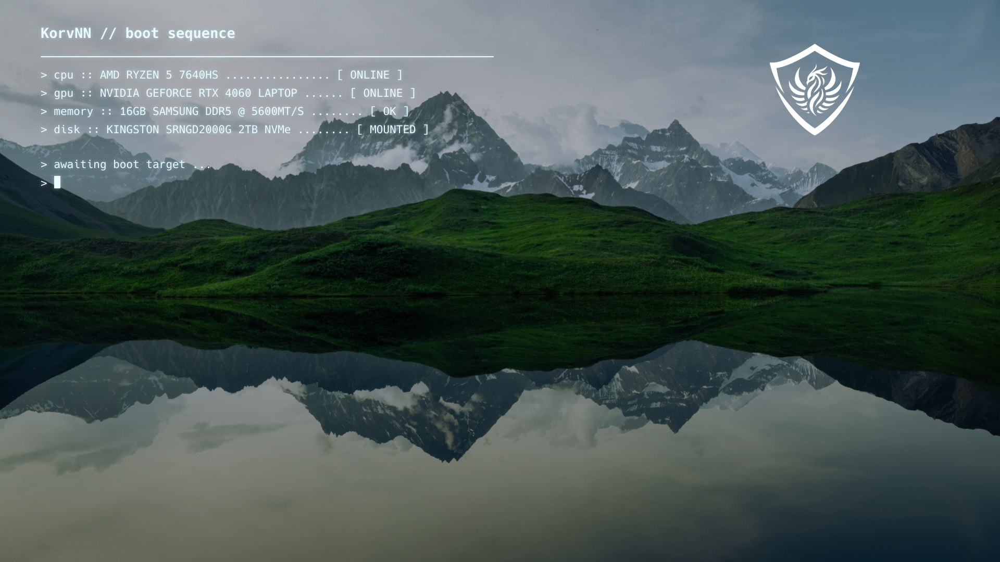

# rEFInd KorvNN Theme

A personalized rEFInd theme configured for 1920x1080, using the original KorvNN mountain-lake wallpaper and boot-sequence heading.

## Preview




## Installation

Copy the repository into the `themes` directory next to `refind_x64.efi` and
name the copied directory `rEFInd-KorvNN`:

```text
EFI/refind/
├── refind.conf
└── themes/
    └── rEFInd-KorvNN/
        ├── background.korvnn.bmp
        ├── icons/
        ├── selection_big.png
        ├── selection_small.png
        └── theme.conf
```

Then add this line to the end of `refind.conf`:

```text
include themes/rEFInd-KorvNN/theme.conf
```

The wallpaper and configured resolution are both 1920x1080. The active wallpaper
is an uncompressed 24-bit BMP, displayed with `banner_scale noscale` to avoid
resizing during boot.

## Customization

- Background: `background.korvnn.bmp` (uncompressed 24-bit RGB)
- PNG source: `background.korvnn.png`
- Theme settings: `theme.conf`
