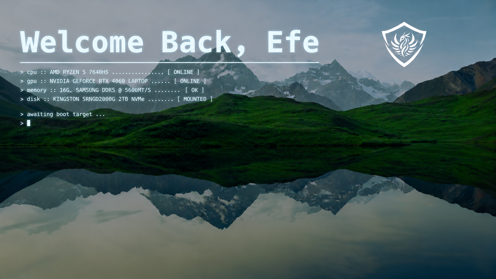

# rEFInd KorvNN Theme

A personalized rEFInd theme configured for 1920x1080. The “Welcome Back, Efe” background is an edit of the original KorvNN image, keeping its mountain-lake composition, terminal hardware readout, and dragon emblem.

## Preview




## Installation

Copy the repository into the `themes` directory next to `refind_x64.efi` and
name the copied directory `rEFInd-KorvNN`:

```text
EFI/refind/
├── refind.conf
└── themes/
    └── rEFInd-KorvNN/
        ├── background.welcome-efe.png
        ├── icons/
        ├── selection_big.png
        ├── selection_small.png
        └── theme.conf
```

Then add this line to the end of `refind.conf`:

```text
include themes/rEFInd-KorvNN/theme.conf
```

The configured resolution is 1920x1080. Change the `resolution` line in
`theme.conf` if your firmware display uses another mode.

## Customization

- Background: `background.welcome-efe.png` (scaled to fill the screen)
- Original background: `background.korvnn.png`. To restore it, change the `banner` line in `theme.conf` to `themes/rEFInd-KorvNN/background.korvnn.png`.
- Image editing: built-in `imagegen`, using `background.korvnn.png` as the source; prompt saved in `background.welcome-efe.prompt.txt`.
- Theme settings: `theme.conf`
